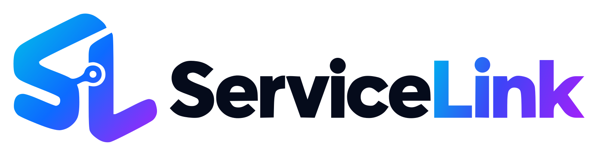

# Service Link brand assets

Approved by Mamu on 25 October 2026.

The connected **SL** monogram and **ServiceLink** wordmark follow AdvisorLink's cyan–blue–violet brand family. No tagline is part of this approved lockup.

| File | Use |
| --- | --- |
| `servicelink-logo.svg` | Preferred scalable horizontal logo; transparent background |
| `servicelink-logo.png` | Transparent horizontal logo, 1600 × 418 px |
| `servicelink-icon.svg` | Scalable square SL monogram |
| `servicelink-icon.png` | Transparent square icon, 1024 × 1024 px |
| `servicelink-logo-preview.png` | White-background preview of the supplied SVG |

## Colors

- Monogram gradient: `#00C4E8` → `#0C6BFF` → `#A621F9`.
- “Link” gradient: `#00AAEF` → `#3F43F7` → `#A121F9`.
- Neutral navy: `#050B1B`.

## Usage

Use the SVG lockup on light backgrounds and the icon for compact placements. Preserve the proportions and clear space; keep the artwork unmodified when integrating it.

Both SVGs contain self-contained vector paths, with no external fonts, raster images or scripts. The PNGs render the same SVG artwork. These are source assets: when the application is implemented, place or import them through its asset pipeline.

The owner approved this design for use in Service Link. The initial concept used the built-in image generation tool with AdvisorLink's repository logo as the reference; the supplied SVGs are cleaned vector conversions of that concept.
